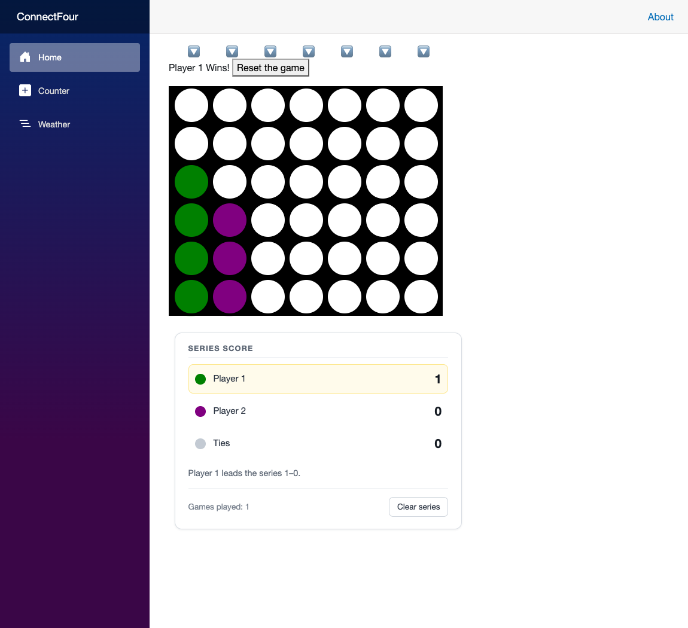

# Connect Four — Blazor

CSE 325, Week 04. A two-player Connect Four game built with Blazor Server, following the
Microsoft Learn module [Build a Connect Four game with Blazor](https://learn.microsoft.com/en-us/training/modules/dotnet-connect-four/),
plus one additional custom feature.

Built by Praise Enato.



## Running it

Requires the .NET 8 SDK.

```bash
dotnet run
```

Then open <http://localhost:5075>.

## From the tutorial

- A `Board` component rendered with the `InteractiveServer` render mode.
- `GameState` registered as a singleton service and injected into the board, keeping
  game state out of the UI.
- A 6×7 board drawn with scoped CSS, with drop animations for the pieces.
- Turn tracking, win detection across horizontals, verticals and both diagonals,
  tie detection, and a reset button.
- Error handling for playing a full column or playing on after the game is over.
- Component parameters for the board and player colors, set from `Home.razor`.

## Additional feature: series scoreboard

The tutorial resets everything when a game ends, so nothing carries between rounds.
This feature adds a running tally that outlives the board.

**What it does**

- Counts Player 1 wins, Player 2 wins and ties across every game in the session.
- Reports who is ahead, e.g. *"Player 1 leads the series 2–1."*
- Highlights whichever row just scored.
- Shows the number of completed games, and offers a **Clear series** button to zero it.
- The tally survives **Reset the game** — that is the point of it. Resetting clears the
  board, not the series.

**How it is built**

`SeriesScore` ([SeriesScore.cs](SeriesScore.cs)) is a separate class registered as its own
singleton in [Program.cs](Program.cs), alongside `GameState`. The split matters:
`GameState` owns one game and is wiped by `ResetBoard()`, while `SeriesScore` owns the
record across games and is not. The `Board` component injects both.

The result is banked in `PlayPiece` the first time a game reaches a finished state:

```csharp
if (winState != GameState.WinState.No_Winner && !resultRecorded)
{
    Series.Record(winState);
    resultRecorded = true;
}
```

The `resultRecorded` flag is what keeps the count honest. Clicking a drop button after a
win re-runs the win check and would otherwise score the same game again on every extra
click. The flag is cleared by `ResetGame()` when the next game starts.

## Layout

| File | Purpose |
| --- | --- |
| [GameState.cs](GameState.cs) | Game logic supplied by the tutorial — board array, turn order, win detection |
| [SeriesScore.cs](SeriesScore.cs) | Custom feature — the cross-game tally |
| [Components/Board.razor](Components/Board.razor) | The board, drop controls, status area and scoreboard |
| [Components/Board.razor.css](Components/Board.razor.css) | Tutorial board styles, plus the scoreboard styles |
| [Components/Pages/Home.razor](Components/Pages/Home.razor) | Hosts the board and passes the color parameters |
